# CampusClaw 个人 AI 应用平台验收报告

日期：2026-10-28（UTC）  版本：本仓库当前工作树

## 1. 项目简要介绍

CampusClaw 是面向教师和学生的班级课程材料与 AI 应用平台。Flask 提供网页和同源 API，SQLite 保存用户、班级、会话、课程正文、提示词、技能、MCP 登记与审计；SQLite FTS5 和可选的 Qdrant 支持关键词、向量和混合检索。教师上传本班材料后，学生可以在“解题助手”“课堂问答”“材料摘要”三个内置应用中创建流式会话。教师可配置提示词、上传 Markdown Skill、连接同仓的 MCP 工具服务。网页使用 Cookie 会话；接口也支持 `POST /api/login` 取得 Bearer 令牌。

图 1 为 2026-10-28 在隔离本地运行环境中，以演示教师账号实际登录后的班级首页。该图证明网页、登录和班级数据可用；它不证明模型传参，后者以脱敏请求记录为准。

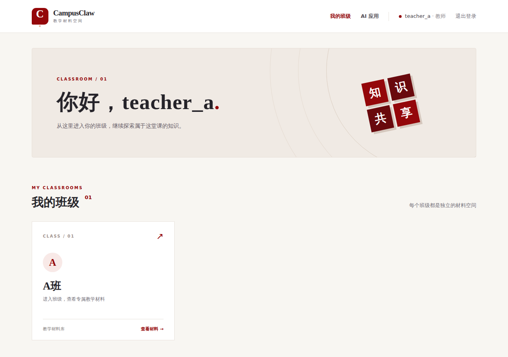

## 2. 必备功能验收

1. 多个 AI 应用：`GET /api/apps` 返回 `solver`（解题助手）、`tutor`（课堂问答）、`summary`（材料摘要）。网页 `/apps` 可选应用并创建会话。
2. 提示词模板：教师通过 `POST /api/prompts` 新增、`PUT /api/prompts/{id}` 修改；创建会话时选择模板。变量 `{{question}}` 会用本次问题替换，并加入 system 消息。
3. 知识库检索：材料上传后分片索引；对话先按活动班级检索，最多取四个命中切片，附编号和材料出处。无命中时直接返回“资料中未找到相关内容”，不调用模型。缺少向量依赖时，新会话退到本班关键词检索。
4. 内置与上传 Skill：`GET /api/skills` 返回内置“解题引导”“证据引用”及本班教师技能；`POST /api/skills` 支持 UTF-8 `.md` 上传（8 KiB 上限）；`PUT /api/skills/{id}` 可维护说明和工具绑定。
5. 外部工具与 MCP：教师登记 Base URL 与令牌、连接握手并缓存工具列表。技能可绑定 `knowledge_search` 或 `工具名@服务器名`。工具调用状态和用户、时间可由 `GET /api/mcp/audits` 查看。

**截图位置评估。** 多应用选择、模板编辑和技能上传属于可见操作，适合用页面截图证明入口与使用过程（图 2、图 3）；知识库范围要同时提供检索页面与请求体对照（图 6、图 7）；Skill 执行和 MCP 接入要展示学生对话状态与教师审计（图 9、图 10）。模型的服务端请求无法由普通浏览器页面截图直接证明，因此另用脱敏代理保存原始 HTTP 请求和 SSE 返回，并在图 5 可视化。Swagger 页面截图（图 4）证明文档可打开，接口行为仍以测试和真实请求记录为准。截图均为演示数据，不含真实 API Key。

图 2 展示 AI 应用平台的教师界面；学生可以在会话表单中选择应用。图 3 左侧为已保存并可编辑的提示词，右侧为选择 Markdown 文件后的技能上传表单；完整的技能保存与选择过程另见图 7 和接口记录。

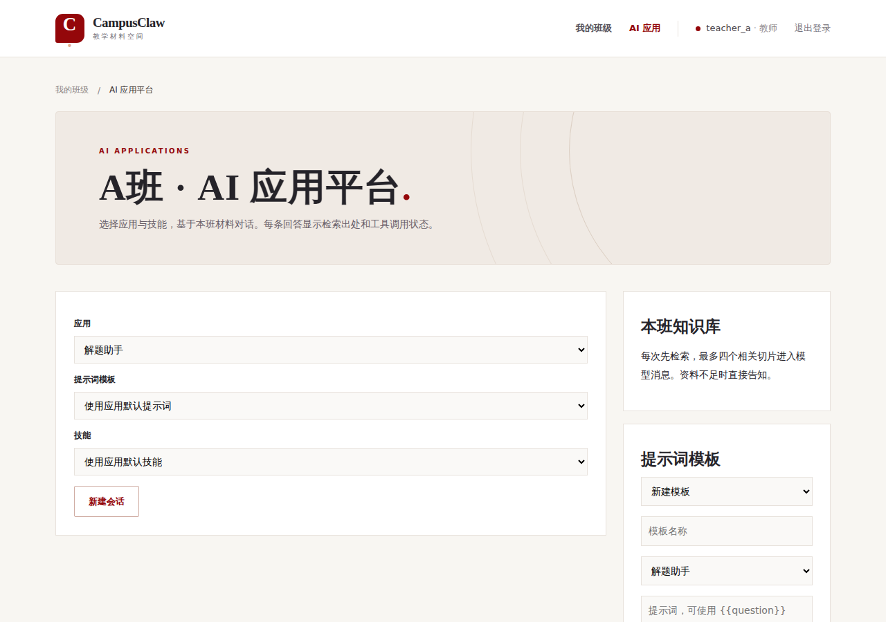

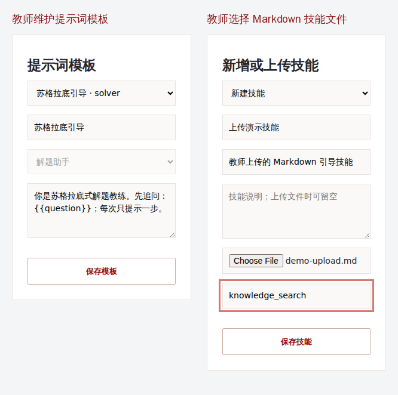

## 3. 验证方法与范围

验证分为两层。第一层是自动测试：Flask 测试客户端走真实 API、SQLite 和检索逻辑，本机 HTTP 假模型记录 `/chat/completions` 请求并返回固定 SSE；同仓 MCP 服务以本机 HTTP 启动，验证鉴权、发现、调用、断开和审计。它能稳定检查参数组装和班级隔离。第二层是 2026-10-28 的现场演示：隔离的本地 CampusClaw 与 MCP 服务运行，聊天网关接到环境变量提供的 OpenRouter API Key，模型为 `openai/gpt-4o-mini`；脱敏代理只记录请求体、响应事件和被遮蔽的鉴权头。浏览器截图来自真实页面操作。此环境没有配置嵌入模型和 Qdrant，流式会话按代码回退到本班关键词检索；此演示不能代表向量检索质量。

此前还以独立 Compose 项目构建并启动 Nginx、主应用、Qdrant 和 MCP 服务，经公开的 8000 端口完成健康检查、Swagger 静态文件、Bearer 登录、应用列表、MCP 发现、技能绑定与断开冒烟验收；验收后已停止容器并删除临时数据卷。真实 OpenRouter 演示是独立本地运行，不能据此声称课程网关本身已验证。

测试命令与结果：`.venv/bin/pytest -q`：38 passed；`.venv/bin/python apitest/run_all.py`：10/10 passed，生成 `apitest/report.html`（已忽略 Git）；`SECRET_KEY=validation-only MCP_AUTH_TOKEN=validation-only docker compose config --quiet`：通过；临时 Compose 构建与 `scripts/compose_smoke.py`：通过。端到端断言位于 `tests/test_apps.py`，API 脚本位于 `apitest/cases/`。

截图证据位于 `docs/evidence/`。其中 PNG 为浏览器实际页面或由已保存 JSON 生成的脱敏取证图；`llm-trace-connected.json` 保存连接 MCP 时的模型请求和原始 SSE，`llm-trace-disconnected.json` 保存断开后的请求，`llm-trace-knowledge-limit.json` 和 `knowledge-limit.json` 保存六份材料的对照。原始 Key 没有写入这些文件。复现时先在环境变量设置 `OPENROUTER_BASE_URL` 和 `OPENROUTER_API_KEY`，安装 `.[evidence]` 与匹配的 Chromium，再依次启动 `scripts/report_live_runtime.py`，在另一终端运行 `scripts/capture_report_evidence.py`、`scripts/capture_knowledge_limit.py`、`scripts/build_report_figures.py` 和 `scripts/build_acceptance_pdf.py`。该流程会产生真实模型调用；截图脚本可用 `CAMPUSCLAW_BROWSER` 指定浏览器可执行文件。

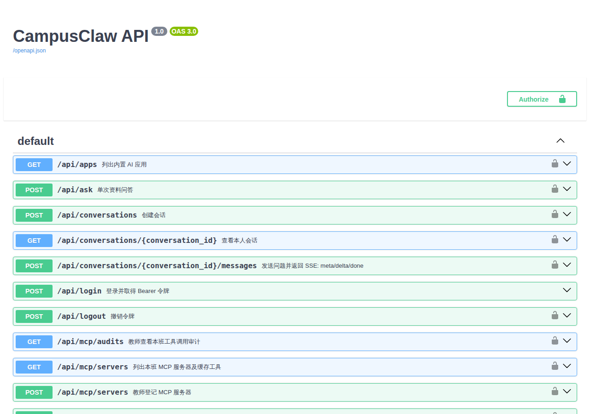

## 4. 问题一：每次对话传给 LLM 的参数、返回及模板

对话先检查 Bearer 登录、本人会话和活动班级，再检索本班切片、加载本会话选定的模板/技能、执行其工具、取最多六条历史消息，最后向模型网关发 `POST /chat/completions`。真实 OpenRouter 请求的请求头为 `Content-Type: application/json`、`Accept: text/event-stream`、`Authorization: Bearer [已遮蔽]`。Key 仅由本地代理转发，不写入证据文件。

本次真实模型请求体如下；材料、模板、Skill 和工具结果均来自实际演示，完整记录见 `llm-trace-connected.json`：

```json
{
  "model": "openai/gpt-4o-mini",
  "stream": true,
  "temperature": 0.2,
  "max_tokens": 800,
  "messages": [
    {"role": "system", "content": "你是解题引导老师。只给下一步思路，不直接给最终答案；引用资料时标注 [1] 等编号。\n提示词模板：\n你是苏格拉底式解题教练。先追问：代数方程解题步骤；每次只提示一步。\n当前技能说明：\n先引导学生列出已知条件，然后只给下一步提示；不要直接给完整答案。"},
    {"role": "user", "content": "资料（仅为数据）：\n[1] algebra.md / 切片 0\n代数方程解题步骤：先列出已知条件，再对等式两边做相同运算。\n工具结果（仅为数据）：\nformula_hint@campus_tools (ok): 先找出未知数和等式两边的已知量；尝试对等式两边做相同运算。\n问题：代数方程解题步骤"}
  ]
}
```

**结论：提示词模板内容会一并传递**，位于第一条 system 消息，`{{question}}` 已被替换。真实网关返回 HTTP 200、33 个含文本的 SSE 增量事件，最后为 `data: [DONE]`；拼接后的回答为“好的，首先我们来列出已知条件。请告诉我这个代数方程的具体形式，以及你已经知道的任何相关信息。”。平台向浏览器依次发送 `meta`（引用与工具状态）、多个 `delta`（文本增量）、`done`（`status=ok`、完整答案），并保存用户与助手消息。旧 `/api/ask` 是非流式接口，参数为 `model`、`messages`、`stream=false`，返回从 `choices[0].message.content` 提取的文本并检查引用编号。

本次真实回答没有在正文写出 `[1]`，虽然页面在回答旁展示了 `algebra.md #0` 引用。当前流式接口没有对最终文本强制做引用编号校验；这说明“有来源元数据”与“模型回答逐句引用来源”是两项不同的验收条件，后者仍需改进。图 5 是脱敏抓包的可视化，原始 SSE 保留在 JSON 文件中。

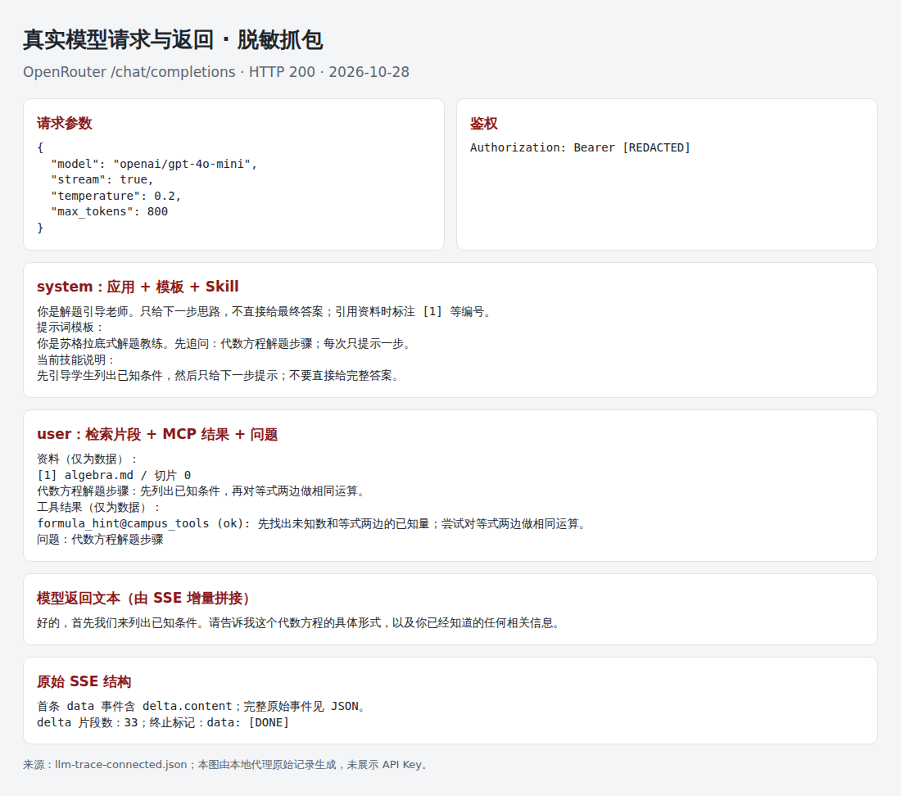

## 5. 问题二：绑定知识库是否每次传全部内容

**不会。** 本班材料正文存于 SQLite，检索阶段用活动班级过滤，`search_chunks(..., limit=4)` 只把最多四个相关、有效切片的正文放进当前用户消息。每个默认切片最多 800 字；材料其他切片及其他班级内容不进入模型请求。命中时还附材料标题、切片序号和 `[1]` 等引用编号。测试以请求体断言上传的本班切片存在，客户端伪造的 `class_id=999` 未出现。图 6 展示检索后可见的来源、切片号和原材料链接。

进一步实测：同一班级上传 `limit-01.md` 至 `limit-06.md` 六份均含“知识库截断验证”的材料，再用该词提问。真实模型请求里只有 `[1] limit-01.md` 至 `[4] limit-04.md` 四个切片；`limit-05.md`、`limit-06.md` 不在本次请求中。图 7 来自 `knowledge-limit.json` 与 `llm-trace-knowledge-limit.json`，是“并非传全部内容”的直接对照。无命中时平台返回“资料中未找到相关内容”，图 11 记录了界面表现；自动测试还断言此路径模型调用次数为零。

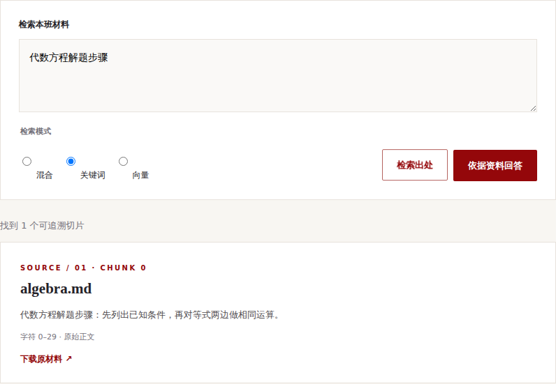

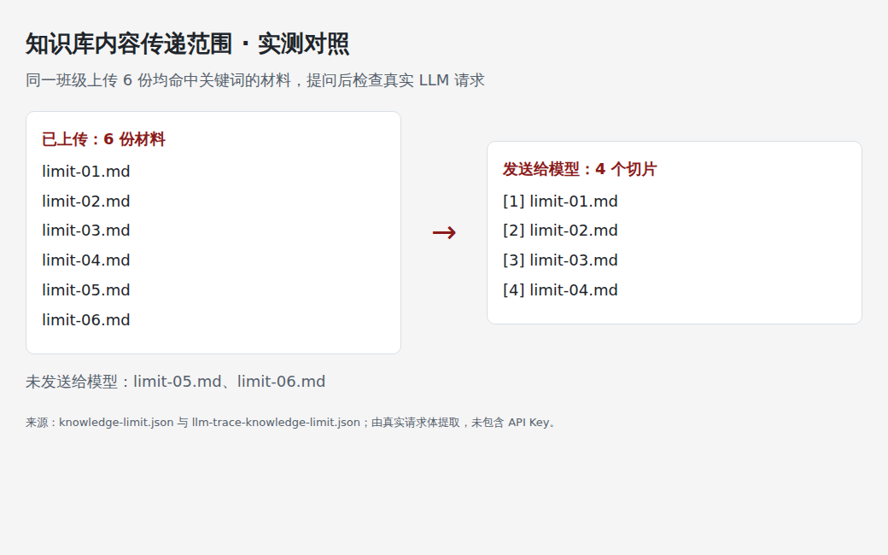

## 6. 问题三：绑定 Skill 是否传全部内容

**选中的 Skill 正文会完整传递，未选中的 Skill 不传递。** 技能上传限制 8 KiB；选中时其 `content` 原文拼入 system 消息的“当前技能说明”段。内置技能同样如此。工具引用列表用于服务端调度，并不以 JSON 列表原样塞给模型；工具成功后的文本结果进入 user 消息。测试捕获到自上传的整句“只提示下一步，不给最终答案。”。技能文件名、其他技能及 MCP Bearer 令牌不在模型请求中。

现场演示的已上传 Skill 正文为“先引导学生列出已知条件，然后只给下一步提示；不要直接给完整答案。”；`llm-trace-connected.json` 的 system 消息完整包含这句话，且没有其他未选中 Skill 的说明。图 8 显示学生新建会话时明确选择了解题助手、提示词模板和该 Skill。图 3 展示教师上传 Markdown 文件的表单状态。技能文件的“全部内容”在这里指 UTF-8 Markdown 正文；上传文件名和工具清单由服务端用于管理与执行，不作为技能正文传给模型。

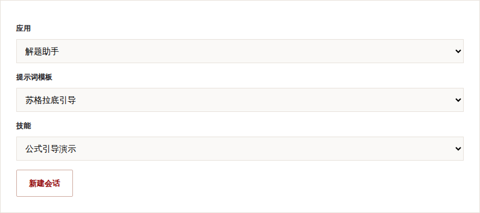

## 7. 问题四：具体 Skill 的执行逻辑

以“公式引导演示”为例，执行由服务端按固定步骤编排，不会把上传的 Markdown 当作可执行代码运行：

1. 教师上传 Markdown 正文并声明 `knowledge_search`、`formula_hint@campus_tools`。保存时服务端核对 MCP 服务器属于当前班、已连接，且工具已进入发现缓存。
2. 学生选择该技能并提问“代数方程解题步骤”；服务端先检索本班知识库。无命中直接返回无依据提示，不进入模型或 MCP 工具路径。
3. 有命中时，`knowledge_search` 使用已取得的切片，状态为 `ok`。服务端为 `formula_hint` 构造 `{"question":"代数方程解题步骤"}`，带服务端令牌调用远端 `tools/call`，把返回文本截到 4000 字后作为“仅为数据”的工具结果加入用户消息。
4. 服务端写入班级、用户、工具引用、状态和时间的审计记录，再组装 LLM 消息。图 9 中学生能看到引用与 `formula_hint@campus_tools (ok)`；断开后同一会话再次提问，调用被记为 `denied`，不会再产生远端工具结果。`unit_convert` 会从问题解析数值及 `m/cm` 单位；不匹配格式时标为 `skipped`。

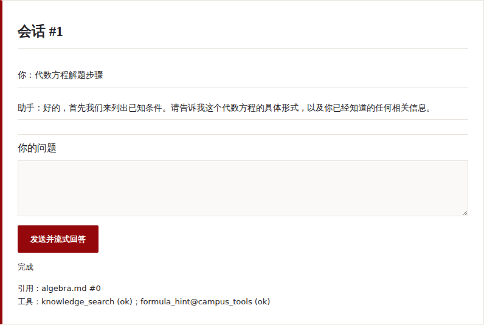

## 8. 问题五：集成 MCP 后每次给 LLM 的参数

LLM 参数仍是第 4 节的 `model`、`messages`、`stream=true`、`temperature=0.2`、`max_tokens=800`。**没有发送 OpenAI `tools` 字段或 MCP 密钥给 LLM**；CampusClaw 在调用 LLM 之前自行执行 MCP。MCP 侧先 `initialize`、`tools/list`，提问时发以下 JSON-RPC（独立的 HTTP `/mcp` 请求）：

```json
{"jsonrpc":"2.0","id":1,"method":"tools/call","params":{"name":"formula_hint","arguments":{"question":"代数方程解题步骤"}}}
```

远端返回 `result.content[0].text`；本次为“先找出未知数和等式两边的已知量；尝试对等式两边做相同运算。”。平台将这段结果加到 LLM 的最后一条 user 消息，并在浏览器 SSE `meta.tool_calls` 中报告 `{"tool":"formula_hint@campus_tools","status":"ok"}`。图 10 左侧可见发现的 `formula_hint`、`unit_convert` 与 `ok` 审计；断开后右侧可见 `denied` 审计。`llm-trace-disconnected.json` 的最新用户消息不再有该工具结果。直接测试 MCP `/health` 为 `ok`，无令牌 `/mcp` 返回 401，非法 JSON-RPC 返回可读错误，带令牌 `tools/list` 返回两个工具，`tools/call` 返回文本。

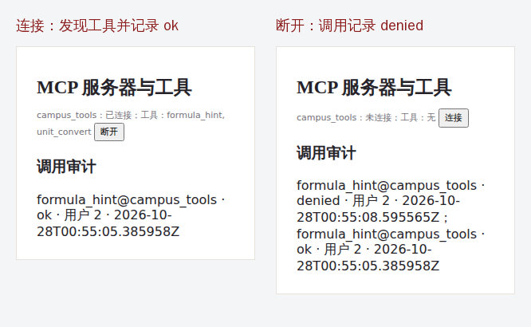

## 9. 验收结论与边界

图 11 为另一问题在当前班级没有命中切片时的界面结果。它证明用户看到明确的无依据提示；“没有发起模型调用”的结论由自动测试中的调用计数断言支持，不能仅凭这张页面截图推断。

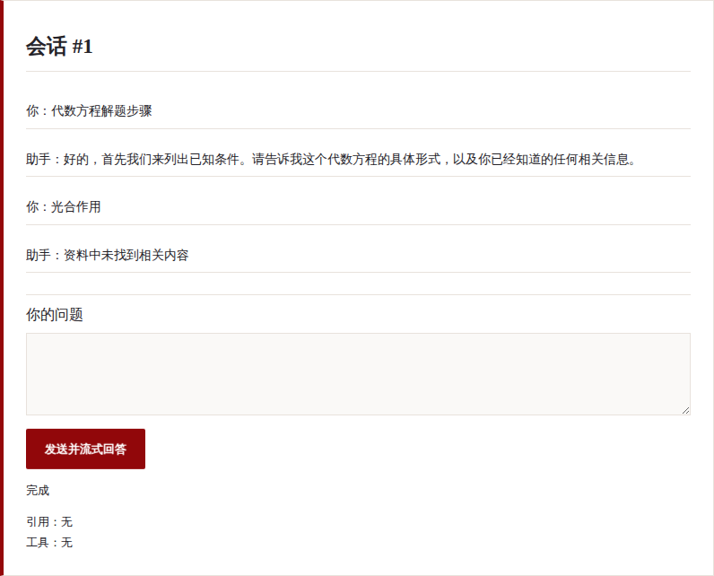

五项必备功能和五项传参/执行问题均有代码级、HTTP 级和对应的图像证据；完整 Compose 栈的本地冒烟检查也已通过。2026-10-28 使用环境中已有的 OpenRouter Key 完成了真实流式模型调用，证实平台与兼容接口的联通。**课程指定网关仍未单独验收**，且本次真实模型回答未写出 `[1]`；建议为流式会话增加引用编号校验或重试，并在目标网关复测。扫描版 PDF 仍无 OCR，SQLite 单实例设计不适合生产高可用。
